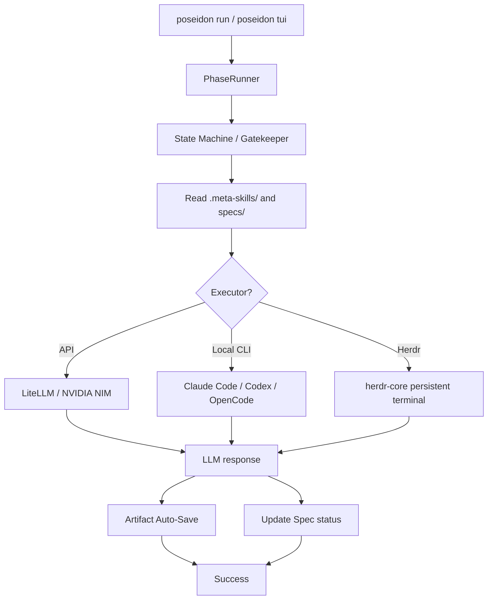

<div align="center">
  
  <h1>🔱 Poseidon Agent</h1>
  <p><strong>The guided autonomous runtime for Keel Nav.</strong></p>
  <p>
    <a href="https://github.com/MrErov/poseidon-agent/releases/tag/v1.0.0-alpha">
      
    </a>
    <a href="https://github.com/MrErov/poseidon-agent/blob/main/pyproject.toml">
      
    </a>
    <a href="https://github.com/MrErov/poseidon-agent/tree/main/tests">
      
    </a>
  </p>
</div>

Poseidón is **the guided autonomous runtime for Keel Nav** — a **local-first AI agent with 3-layer cognitive memory**:

- **Cold Memory:** Keel Nav phases and project specifications loaded from disk.
- **Hot Memory:** a fresh message list for each execution, with Goldfish isolation.
- **Context and Graph Memory:** repository context and optional Graphify dependencies injected around the specification.

## Why Poseidon is Different

Unlike free-loop agents such as **Hermes-Agent**, Poseidón does not improvise: **it obeys a map**. Keel Nav defines the route, while Poseidón handles execution, persistence, and evidence. The Navigator remains in control of every transition.

## 4 Pillars

- **Guided 5-Phase Engine (Keel Nav native):** Context Bootstrap, Spec Writer, Goldfish Audit, Strict TDD, ODD Vertical Slice, and Drift Control, all guarded by deterministic state transitions.
- **Full Local & OS Agency:** persistent Herdr terminals, local CLIs, and direct subprocess execution without surrendering control of the repository to a hosted agent.
- **Human-in-the-Loop:** the Gatekeeper blocks unapproved work, while artifacts and verdicts keep every decision inspectable.
- **Multi-Channel:** command-line execution today, an interactive Textual TUI now, and future desktop channels.


## Ecosystem

| Component | Responsibility |
|-----------|----------------|
| **Keel Nav** | Defines the phases, templates, gates, and conventions that make up Cold Memory. |
| **Poseidón Agent** | Resolves phases, isolates memory, delegates inference, saves artifacts, and enforces the state machine. |
| **DeepSeek plugin** | Provides invocation within the DeepSeek experience; it neither replaces the engine nor implies use of the DeepSeek API. |
| **NVIDIA NIM or local CLIs** | Execute inference through LiteLLM or Claude Code, Codex, and OpenCode. |
| **Graphify MCP** | Optionally injects dynamic code-graph context into Phases 1a and 1b. |

Keel Nav provides the protocol, Poseidón executes it, and the DeepSeek plugin makes it accessible while keeping each responsibility separate.

## Architecture



## Memory Model

- **Cold Memory:** instructions resolved from `.meta-skills/` using a phase alias or an exact filename; phases belong to the target project, not to Poseidón.
- **Hot Memory:** a new message list for every call, with no previous history.
- **Context:** the content of `--context` is injected before `--spec` into Hot Memory.
- **Goldfish Audit:** any phase resolved as `02-egm-goldfish-audit` displays its memory-isolation warning and runs without history.

## Phase Aliases

| Alias | File in `.meta-skills/` |
|-------|--------------------------|
| `0`, `00`, `context` | `00-context-bootstrap.md` |
| `1a`, `spec` | `01-sdd-spec-writer.md` |
| `1b`, `goldfish` | `02-egm-goldfish-audit.md` |
| `2`, `tdd` | `03-tdd-cycle.md` |
| `3`, `odd` | `04-odd-vertical-slice.md` |
| `4`, `drift` | `05-drift-control.md` |

You can also provide the exact filename, with or without `.md`. If the phase does not match an alias, Poseidón searches for a Markdown file whose name starts with or contains the phase. If no match is found, it stops with a controlled error. The same resolution is used to load Cold Memory, save artifacts, and update the spec.

## Requirements and Installation

You need Python 3.10 or later and [uv](https://docs.astral.sh/uv/).

```bash
uv venv
# Linux/macOS:
source .venv/bin/activate
# Windows PowerShell:
# .venv/Scripts/Activate.ps1
uv pip install -e .
```

Create a `.env` file with your NVIDIA NIM credential. Graphify MCP is optional:

```dotenv
NVIDIA_NIM_API_KEY=...

# Optional: enable Graphify MCP for Phases 1a and 1b.
GRAPHIFY_MCP_URL=https://api.graphify.com/mcp
```

## Usage

Run Poseidón from the root of the project that contains `.meta-skills/`. The `--spec` argument is optional for phases such as Context Bootstrap and Phase 1a:

```bash
poseidon run --phase 00-context-bootstrap --model nvidia_nim/<available-model>
poseidon run --phase 1a --spec specs/US-001.md --context docs/context/api.md --model nvidia_nim/<available-model>
poseidon run --phase 1b --spec specs/US-001.md --context docs/context/api.md --model nvidia_nim/<available-model>
```

Replace `<available-model>` with the identifier of a model enabled in your NVIDIA NIM account. Credentials are loaded automatically from `.env`.

### Local Executors (Delegation Engine)

With `--executor api` (the default), Poseidón uses LiteLLM and `--model` is required. You can also delegate the prompt to an installed and authenticated local CLI; in that case, `--model` is omitted and the tool uses its own configuration:

```bash
poseidon run --phase 1b --spec specs/US-001.md --context docs/context/api.md --executor claude-code
poseidon run --phase 2 --spec specs/US-001.md --executor codex
poseidon run --phase 0 --executor opencode
```

| Executor | Invocation |
|----------|------------|
| `claude-code` | `claude -p --output-format text`, with the prompt passed through stdin |
| `codex` | `codex exec -`, with the prompt passed through stdin |
| `opencode` | `opencode run -`, with the prompt passed through stdin |

Every delegation receives a fresh prompt, including isolated Goldfish execution. All three executors receive the prompt through `stdin`, never as a positional argument, to avoid operating-system command-line length limits. Subprocesses have a 300-second timeout, do not use a shell, and raise a controlled error if the executable is unavailable, times out, or returns a non-zero exit code.

If an executable is not in `PATH`, set its path with `POSEIDON_CLAUDE_CODE_BIN`, `POSEIDON_CODEX_BIN`, or `POSEIDON_OPENCODE_BIN`.

### Agent Roles & Herdr Integration

Poseidón 2.0 introduces role-based execution through an optional `config.yaml`. Roles select the executor and model for each phase, while Herdr keeps supported agents alive in persistent terminals managed by `herdr-core`.

```yaml
version: 2
roles:
  architect:
    executor: api
    model: nvidia_nim/moonshotai/kimi-k2-instruct
  tester:
    executor: claude-code
    model: null
    runtime: herdr
    name_prefix: poseidon-tester
phase_roles:
  0: architect
  1a: architect
  1b: tester
  2: tester
  3: tester
  4: architect
herdr:
  executable: hc
  wait_timeout_seconds: 900
  read_lines: 1000
  keep: true
  outlive_parent: true
  fallback_to_subprocess: false
```

Resolution follows this precedence: explicit CLI role, executor, or model; role settings; `phase_roles`; then API defaults. A role with `runtime: herdr` uses Herdr, while its `executor` identifies the agent launched inside the persistent terminal.

Install `herdr-core` using the [official instructions](https://herdr.dev/core/), then verify it with `hc server status`. On Windows, PowerShell users can run:

```powershell
powershell -c "irm https://releases.herdr.dev/core/install.ps1 | iex"
```

Run a configured role or select Herdr explicitly:

```bash
poseidon run --phase 1b --role tester
poseidon run --phase 1b --executor herdr --herdr-agent codex
```

Poseidón appends a newline to the prompt when needed, ensuring terminal-based agents submit it as if Enter had been pressed. The default Herdr wait timeout is 900 seconds.

Poseidón uses JSON-RPC 2.0 over `hc connect` to call `terminal.run`, `terminal.send`, `terminal.wait`, and `terminal.read`. The full prompt travels as a JSON string rather than a command-line argument, preserving Goldfish isolation and avoiding OS command-line limits. Agents remain alive if Poseidón closes or a request times out; controlled errors include the terminal address for `hc attach`.

Missing executables, connection failures, JSON-RPC errors, empty output, and timeouts produce controlled errors. There is no silent fallback to a non-persistent subprocess when `fallback_to_subprocess` is `false`.

### Textual TUI (v3.0)

Launch the interactive terminal interface with:

```bash
poseidon tui
```

The Textual layout includes a header with the current state, a left panel with all Keel Nav phases, a right `RichLog` for streamed responses, and a footer with keyboard shortcuts. Select a phase and press **Ctrl+R** to execute it in a background worker; **Ctrl+Q** exits the application.

Console output and the final response are forwarded to the RichLog without blocking the interface. API, local CLI, and Herdr executors are resolved through the same role configuration used by `poseidon run`.

### Graphify MCP (Optional)

Set `GRAPHIFY_MCP_URL` to enrich Phases 1a and 1b with code-graph context. The suggested default URL is `https://api.graphify.com/mcp`. Poseidón queries using the `--spec` path, or the `--context` path when no spec is provided, and injects the response between the context and the specification.

If the variable is missing or empty, the request fails, or the response contains no usable text, Poseidón continues without Graphify context and without interrupting execution.

### Automatic Artifacts

Phases that produce Markdown save their artifacts under `specs/`, relative to the project where Poseidón is invoked:

| Phase | Generated file |
|-------|----------------|
| `1a` | `specs/<name>.spec.md` |
| `1b` or `goldfish` | `specs/<name>.audit.<N>.md` (next available audit number) |
| `2` or `tdd` | Console only |
| `3` or `odd` | `specs/<name>.observation.md` |
| `4` or `drift` | `specs/<name>.drift.<N>.md` (next available drift round) |

The name is derived from `--spec`, or from `--context` when no spec is provided, by removing the `.md` or `.spec.md` extension. Successful saves are shown in green. Write failures are reported as controlled errors with exit code `1`.

### Spec State Machine

After a `1b` or `goldfish` audit, Poseidón searches for `verdict` or `effective_verdict` in the generated report:

- `audited`: updates only the spec frontmatter, changing `status: draft` to `status: audited` and `goldfish_audit: pending` to the generated audit path.
- `rejected` or a missing verdict: leaves the spec unchanged in `draft`.

Updates are limited to the initial frontmatter. Fields such as `us_id` and `created_at`, along with the Markdown body, are preserved.

In Phase 3 (`odd`), Poseidón saves the observation and updates the spec to `status: observed` when the report explicitly declares `verdict: approved`, `effective_verdict: approved`, or `status: observed`.

In Phase 4 (`drift`), `no-drift` and `drifted-accepted` update the spec to `status: certified` and register `drift_report`. A `drifted` verdict leaves the spec untouched and prints a red rejection message. When present, `effective_verdict` takes precedence over `verdict`.

### TDD Gatekeeper

Phase `2` and any phase containing `tdd` require a spec whose frontmatter contains `status: audited` or `status: approved`. A status such as `draft`, a missing status, or a missing spec blocks execution before any LLM call.

If a required phase file or a supplied specification does not exist, Poseidón exits with code `1` and prints a controlled error in red.

## Development

```bash
uv pip install -e ".[dev]"
uv run pytest
uv run ruff check .
```

Project structure:

```text
src/poseidon/
├── config_manager.py   # Role and phase executor resolution
├── core.py             # PhaseRunner, memory, and executor selection
├── delegator.py        # Local CLI delegation through subprocesses
├── herdr_delegator.py  # Persistent agents through herdr-core JSON-RPC
├── main.py             # Typer CLI and error handling
├── mcp_client.py       # Optional Graphify MCP integration
└── __init__.py
```
