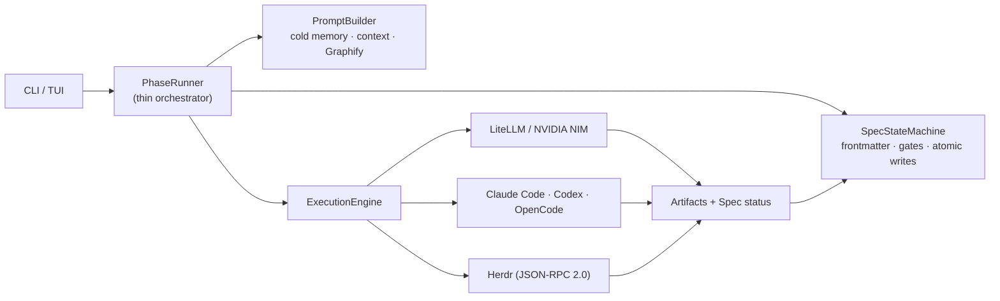

<div align="center">
  
  <h1>🔱 Poseidon Agent</h1>
  <p><strong>The guided autonomous runtime for Keel Nav. A local-first AI agent with 3-layer cognitive memory.</strong></p>
  <p>
    
    
    
    
  </p>
</div>

<div align="center">
  
</div>

Poseidón is the deterministic execution engine for the **Keel Nav** protocol. It turns a guided map into auditable software: it isolates memory, delegates inference, persists artifacts and enforces state transitions — the Navigator stays in control of every step.

## Why Poseidon?

| | Free-loop Agents (Hermes, etc.) | Poseidon Agent |
|---|---|---|
| **Memory** | Conversation history grows unbounded; context drifts between turns. | **3-layer cognitive memory**: immutable Cold Memory on disk, a fresh Hot Memory per run, and Context/Graph Memory injected only where needed. |
| **Validation** | The agent self-reports success; no deterministic gate. | **Gatekeeper + strict state machine**: TDD is blocked until a spec is `audited`/`approved`; verdicts are parsed only from a report frontmatter, never from free text. |
| **Orchestration** | The model improvises the next action. | **The map rules**: a thin orchestrator coordinates `SpecStateMachine`, `PromptBuilder` and `ExecutionEngine`. Every transition is explicit, typed and atomic. |

## 4 Pillars

- **Guided 5-Phase Engine (Keel Nav native):** Context Bootstrap, Spec Writer, Goldfish Audit, Strict TDD, ODD Vertical Slice and Drift Control, guarded by deterministic transitions.
- **Full Local & OS Agency:** persistent Herdr terminals, local CLIs and isolated subprocesses — no shell, prompts via stdin.
- **Human-in-the-Loop:** the Gatekeeper blocks unapproved work; artifacts and verdicts keep every decision inspectable.
- **Multi-Channel:** CLI and an interactive Textual TUI today, future desktop channels.

## Architecture



## Ecosystem

| Component | Responsibility |
|-----------|----------------|
| **Keel Nav** | Defines the phases, templates, gates and conventions that make up Cold Memory. |
| **Poseidón Agent** | Resolves phases, isolates memory, delegates inference, saves artifacts and enforces the state machine. |
| **DeepSeek plugin** | Provides invocation inside the DeepSeek experience; it neither replaces the engine nor implies use of the DeepSeek API. |
| **NVIDIA NIM or local CLIs** | Execute inference through LiteLLM or Claude Code, Codex and OpenCode. |
| **Graphify MCP** | Optionally injects dynamic code-graph context into Phases 1a and 1b. |

## Memory Model

- **Cold Memory:** instructions resolved from `.meta-skills/` using a phase alias or exact filename; phases belong to the target project, not to Poseidón.
- **Hot Memory:** a new message list for every call, with no previous history.
- **Context:** the content of `--context` is injected before `--spec` into Hot Memory.
- **Goldfish Audit:** any phase resolved as `02-egm-goldfish-audit` displays its memory-isolation warning and runs without history.

## Phase Aliases

| Alias | File in `.meta-skills/` |
|-------|--------------------------|
| `0`, `00`, `context` | `00-context-bootstrap.md` |
| `1a`, `spec` | `01-sdd-spec-writer.md` |
| `1b`, `goldfish` | `02-egm-goldfish-audit.md` |
| `2`, `tdd` | `03-tdd-cycle.md` |
| `3`, `odd` | `04-odd-vertical-slice.md` |
| `4`, `drift` | `05-drift-control.md` |

You can also provide the exact filename, with or without `.md`. If the phase does not match an alias, Poseidón searches for a Markdown file whose name starts with or contains the phase. If no match is found, it stops with a controlled error.

## Requirements and Installation

Python 3.10+ and [uv](https://docs.astral.sh/uv/).

```bash
uv venv
# Linux/macOS: source .venv/bin/activate
# Windows PowerShell: .venv/Scripts/Activate.ps1
uv pip install -e .
```

Create a `.env` file with your NVIDIA NIM credential (Graphify is optional):

```dotenv
NVIDIA_NIM_API_KEY=...
# GRAPHIFY_MCP_URL=https://api.graphify.com/mcp
```

## Usage

Run Poseidón from the project root containing `.meta-skills/`:

```bash
poseidon run --phase 00-context-bootstrap --model nvidia_nim/<available-model>
poseidon run --phase 1a --spec specs/US-001.md --context docs/context/api.md --model nvidia_nim/<available-model>
poseidon run --phase 1b --spec specs/US-001.md --context docs/context/api.md --model nvidia_nim/<available-model>
```

### Local Executors

With `--executor api` (default) `--model` is required. Otherwise the CLI manages its own auth:

```bash
poseidon run --phase 1b --spec specs/US-001.md --executor claude-code
poseidon run --phase 2 --spec specs/US-001.md --executor codex
poseidon run --phase 0 --executor opencode
```

| Executor | Invocation |
|----------|------------|
| `claude-code` | `claude -p --output-format text` (prompt via stdin) |
| `codex` | `codex exec -` (prompt via stdin) |
| `opencode` | `opencode run -` (prompt via stdin) |

All subprocesses use `shell=False`, a 300 s timeout and controlled errors. Override binaries with `POSEIDON_CLAUDE_CODE_BIN`, `POSEIDON_CODEX_BIN` or `POSEIDON_OPENCODE_BIN`.

### Agent Roles & Herdr

```yaml
version: 2
roles:
  architect: { executor: api, model: nvidia_nim/moonshotai/kimi-k2-instruct }
  tester:    { executor: opencode, model: null, runtime: herdr, name_prefix: poseidon-tester }
phase_roles:
  0: architect
  1a: architect
  1b: tester
  2: tester
  3: tester
  4: architect
herdr:
  executable: hc
  wait_timeout_seconds: 900
  read_lines: 1000
  keep: true
  outlive_parent: true
```

Precedence: CLI flags → role → `phase_roles` → API defaults. Herdr uses JSON-RPC 2.0 over `hc connect` (`terminal.run`, `terminal.send`, `terminal.wait`, `terminal.read`) with strict response validation; controlled errors include the terminal address for `hc attach`.

### Textual TUI

```bash
poseidon tui
```

Select a phase, fill **Spec Path** / **Context Path**, press **Ctrl+R** to run in a background worker, **Ctrl+X** to cancel, **Ctrl+Q** to quit. Output is forwarded to the `RichLog` without blocking the interface.

### Automatic Artifacts

| Phase | Generated file |
|-------|----------------|
| `1a` | `specs/<name>.spec.md` |
| `1b` | `specs/<name>.audit.<N>.md` |
| `2` | Console only |
| `3` | `specs/<name>.observation.md` |
| `4` | `specs/<name>.drift.<N>.md` |

Writes are atomic (temp file + `os.replace`). Verdicts come only from the report frontmatter via `yaml.safe_load`; free text is ignored.

### Spec State Machine

Valid transitions: `draft → audited → {approved, observed} → certified`. Illegal jumps raise `IllegalTransitionError`. Phase 2 requires `audited` or `approved` before any inference call.

## Development

```bash
uv pip install -e ".[dev]"
uv run pytest
uv run ruff check .
vhs demo.tape   # regenerates docs/assets/tui-demo.gif
```

## Changelog Highlights

- **v3.4.0** — Marketing Release: product-style READMEs, VHS demo script and Keel Nav protocol README.
- **v3.3.0** — Production-Ready Architecture: decoupled `PhaseRunner`, atomic persistence and strict config validation.
- **v3.2.0** — TUI inputs, Herdr JSON-RPC hardening, 300 s timeout, `Ctrl+X` cancellation.
- **v3.1.0** — Secure Gatekeeper, strict state transitions, frontmatter-only verdict extraction.

## License

MIT License.
