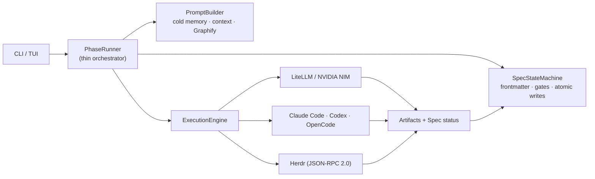

<div align="center">
  
  <h1>🔱 Poseidon Agent</h1>
  <p><strong>The guided autonomous runtime for Keel Nav.</strong> A local-first AI agent with 3-layer cognitive memory.</p>
  <p>
    <a href="https://github.com/MrErov/poseidon-agent/releases/latest">
      
    </a>
    <a href="https://github.com/MrErov/poseidon-agent/actions/workflows/ci.yml">
      
    </a>
    <a href="https://github.com/MrErov/poseidon-agent/blob/main/LICENSE">
      
    </a>
    <a href="https://github.com/MrErov/poseidon-agent/tree/main/tests">
      
    </a>
    <a href="https://github.com/MrErov/poseidon-agent/releases/latest">
      
    </a>
    <a href="https://github.com/MrErov/poseidon-agent/issues">
      
    </a>
    <a href="https://github.com/MrErov/poseidon-agent/stargazers">
      
    </a>
  </p>
</div>

<div align="center">
  
</div>

## 🚀 5-Minute Quickstart

```bash
# 1. Install (Python 3.10+, uv recommended)
uv tool install poseidon-agent
# or: pipx install poseidon-agent
# or: pip install poseidon-agent

# 2. Navigate to your project (must have .meta-skills/ with phase templates)
cd my-project

# 3. Optional: create config.yaml for custom roles/executors
cat > config.yaml <<'EOF'
version: 2
default_role: tester
roles:
  tester:
    executor: api
    model: nvidia_nim/nemotron-3-ultra
EOF

# 4. Run the interactive wizard
poseidon run -i
# Follow prompts: select phase → spec → role → watch it execute

# That's it! Check generated artifacts in specs/
```

**No config?** Poseidon works with smart defaults: `uv tool install poseidon-agent` → `cd your-project` → `poseidon run -i`.

---

Poseidón is the deterministic execution engine for the **Keel Nav** protocol. It turns a guided map into auditable software: it isolates memory, delegates inference, persists artifacts and enforces state transitions — the Navigator stays in control of every step.

---

## 🎯 Why Poseidon?

| | Free-Loop Agents (Hermes, AutoGPT, etc.) | **Poseidon Agent** |
|:---|:---|:---|
| **Memory** | Unbounded conversation history; context drifts between turns | **3-Layer Cognitive Memory**: Immutable Cold Memory on disk, fresh Hot Memory per run, Context/Graph Memory injected only where needed |
| **Validation** | Self-reports success; no deterministic gate | **Gatekeeper + Strict State Machine**: TDD blocked until spec is `audited`/`approved`; verdicts parsed only from report frontmatter |
| **Orchestration** | Model improvises next action | **The Map Rules**: Thin orchestrator coordinates `SpecStateMachine`, `PromptBuilder`, `ExecutionEngine` |
| **Auditability** | Opaque decision trail | **Full Traceability**: Every phase produces immutable artifacts; every transition logged and verifiable |
| **Control** | Agent decides next step | **Human-in-the-Loop**: Gatekeeper blocks unapproved work; Navigator authorizes every phase transition |

> **Poseidon doesn't replace the Navigator—it makes the Navigator's intent executable and verifiable.**

> **Poseidon doesn't replace the Navigator—it makes the Navigator's intent executable and verifiable.**

---

## 🏛️ Four Pillars of Poseidon

| Pillar | Description |
|--------|-------------|
| **🎯 Guided 5-Phase Engine** (Keel Nav Native) | Context Bootstrap → Spec Writer → Goldfish Audit → Strict TDD → ODD Vertical Slice → Drift Control. Every phase gated by deterministic transitions. |
| **🏠 Full Local & OS Agency** | Persistent Herdr terminals, local CLIs, isolated subprocesses — no shell, prompts via stdin. Your machine, your rules. |
| **🛡️ Human-in-the-Loop** | Gatekeeper blocks unapproved work; artifacts and verdicts keep every decision inspectable. The human stays in command. |
| **🌐 Multi-Channel** | CLI today, interactive Textual TUI now, future desktop channels. One engine, multiple interfaces. |

## Architecture



## Ecosystem

| Component | Responsibility |
|-----------|----------------|
| **Keel Nav** | Defines the phases, templates, gates and conventions that make up Cold Memory. |
| **Poseidón Agent** | Resolves phases, isolates memory, delegates inference, saves artifacts and enforces the state machine. |
| **DeepSeek plugin** | Provides invocation inside the DeepSeek experience; it neither replaces the engine nor implies use of the DeepSeek API. |
| **NVIDIA NIM or local CLIs** | Execute inference through LiteLLM or Claude Code, Codex and OpenCode. |
| **Graphify MCP** | Optionally injects dynamic code-graph context into Phases 1a and 1b. |

## Memory Model

- **Cold Memory:** instructions resolved from `.meta-skills/` using a phase alias or exact filename; phases belong to the target project, not to Poseidón.
- **Hot Memory:** a new message list for every call, with no previous history.
- **Context:** the content of `--context` is injected before `--spec` into Hot Memory.
- **Goldfish Audit:** any phase resolved as `02-egm-goldfish-audit` displays its memory-isolation warning and runs without history.

## Phase Aliases

| Alias | File in `.meta-skills/` |
|-------|--------------------------|
| `0`, `00`, `context` | `00-context-bootstrap.md` |
| `1a`, `spec` | `01-sdd-spec-writer.md` |
| `1b`, `goldfish` | `02-egm-goldfish-audit.md` |
| `2`, `tdd` | `03-tdd-cycle.md` |
| `3`, `odd` | `04-odd-vertical-slice.md` |
| `4`, `drift` | `05-drift-control.md` |

You can also provide the exact filename, with or without `.md`. If the phase does not match an alias, Poseidón searches for a Markdown file whose name starts with or contains the phase. If no match is found, it stops with a controlled error.

## Requirements and Installation

Python 3.10+ and [uv](https://docs.astral.sh/uv/).

```bash
uv venv
# Linux/macOS: source .venv/bin/activate
# Windows PowerShell: .venv/Scripts/Activate.ps1
uv pip install -e .
```

Create a `.env` file with your NVIDIA NIM credential (Graphify is optional):

```dotenv
NVIDIA_NIM_API_KEY=...
# GRAPHIFY_MCP_URL=https://api.graphify.com/mcp
```

### Standalone binary (optional)

If you don't want to use Python, download the executable binary from the releases page.

Build it locally with PyInstaller:

```powershell
./scripts/build_binary.ps1
```

```bash
./scripts/build_binary.sh
```

The one-file executable is written to `dist/` (`poseidon.exe` on Windows, `poseidon` elsewhere).

## Usage

Run Poseidón from the project root containing `.meta-skills/`:

```bash
poseidon run --phase 00-context-bootstrap --model nvidia_nim/<available-model>
poseidon run --phase 1a --spec specs/US-001.md --context docs/context/api.md --model nvidia_nim/<available-model>
poseidon run --phase 1b --spec specs/US-001.md --context docs/context/api.md --model nvidia_nim/<available-model>
```

### Smart Defaults & Interactive Wizard

`--spec` and `--role` are optional:

```bash
poseidon run --phase 1b
```

- When `specs/` contains exactly one `*.spec.md`, Poseidón uses it and prints `ℹ️ Auto-detectado spec: specs/US-002.spec.md`.
- The role is resolved from `--role`, then `phase_roles`, then `default_role` in `config.yaml`, and finally `tester`.
- `poseidon run` without arguments or with `-i` opens a wizard for phase, spec, and role.
- `poseidon status` prints a Rich table with available phases, each spec's `status:`, and the default role.

### Local Executors

With `--executor api` (default) `--model` is required. Otherwise the CLI manages its own auth:

```bash
poseidon run --phase 1b --spec specs/US-001.md --executor claude-code
poseidon run --phase 2 --spec specs/US-001.md --executor codex
poseidon run --phase 0 --executor opencode
```

| Executor | Invocation |
|----------|------------|
| `claude-code` | `claude -p --output-format text` (prompt via stdin) |
| `codex` | `codex exec -` (prompt via stdin) |
| `opencode` | `opencode run` (no positional message; prompt via stdin) |

All subprocesses use `shell=False`, a 300 s timeout and controlled errors. Override binaries with `POSEIDON_CLAUDE_CODE_BIN`, `POSEIDON_CODEX_BIN` or `POSEIDON_OPENCODE_BIN`.

### Agent Roles & Herdr

```yaml
version: 2
default_role: tester
roles:
  architect: { executor: api, model: nvidia_nim/moonshotai/kimi-k2-instruct }
  tester:    { executor: opencode, model: nvidia/nvidia/nemotron-3-ultra-550b-a55b, runtime: herdr, name_prefix: poseidon-tester }
phase_roles:
  0: architect
  1a: architect
  1b: tester
  2: tester
  3: tester
  4: architect
herdr:
  executable: hc
  wait_timeout_seconds: 900
  read_lines: 1000
  keep: true
  outlive_parent: true
  mode: persistent  # persistent | headless
  launch: headless_in_terminal  # interactive | headless_in_terminal
  agent_model: ""  # optional; adds --model "<model>" when set
  agent_args: []   # extra CLI arguments appended to the agent command
  auto_approve: true  # adds --auto to OpenCode; set false for manual permission prompts
  total_timeout_seconds: 3600  # total deadline; wait is a resumable check-in
  progress_interval_seconds: 30  # poll progress every 30 seconds
  phase_timeouts: {}  # optional per-phase deadlines, for example {'0': 14400}
```

Precedence: CLI flags → role → `phase_roles` → API defaults. Herdr uses one JSON-RPC 2.0 session per run over `hc connect`, with a stable caller identity and strict response validation.

**Headless-in-terminal (default):** Poseidon writes the prompt to `.poseidon/tmp/<uuid>.prompt.md`, starts a non-interactive command with `terminal.run`, waits for the command to exit with `terminal.wait`, and retrieves the response with `terminal.read`. Prompt files are always deleted in `finally`; `.poseidon/tmp/` is gitignored. Shell redirection keeps prompt contents out of Windows' 8191-character command-line limit. Set `herdr.agent_model` to add `--model "<model>"`; `agent_args` appends extra arguments. Paths with spaces are quoted. OpenCode also receives `--auto` by default, auto-approving permissions not explicitly denied (dangerous). Set `auto_approve: false` to require manual permission prompts.

**Model selection:** `herdr.agent_model` takes precedence. If it is empty, Poseidon uses the role's `model`, then an explicit `--model` CLI value. This prevents an empty model from silently falling back to an invalid OpenCode default.

**Debug logging:** add `--debug` to print the exact command sent to `hc connect`, JSON-RPC responses, the terminal ID, and the command to attach with `hc attach <id>`. Debug terminals remain alive for inspection; no `hc kill` or `hc rm` is issued by debug mode. Logs may include prompt and response content, so enable them only for local troubleshooting.

**Artifact ownership:** Poseidon calculates the exact report path before launch, injects it into the prompt, reads that file afterward, validates its frontmatter, and updates the spec atomically. Agent stdout is never saved as the audit report; a coherent newer report can be used as a fallback.

**Interactive (experimental):** the existing TUI flow uses `terminal.send(wait: true)` with the **real terminal address as caller**, falling back to `terminal.wait` with the same address. This requires an agent that reports status to Herdr. OpenCode's TUI may report no status and no turn, so an interactive agent that answers and remains open cannot be waited on reliably. Use `launch: headless_in_terminal` for deterministic completion.

**Headless machine execution:** `herdr.mode: headless` still supports one-shot `machine.exec` calls with base64 stdin, capped at 600 seconds. OpenCode uses `opencode run --format json` with stdin (no `-` argument).


### Troubleshooting Herdr
### Long phases and resumable waiting

A `terminal.wait` timeout is only a check-in, not proof that the agent stopped. Poseidon resumes the wait until `herdr.total_timeout_seconds` (default 3600), polling `terminal.read` every `progress_interval_seconds` and showing the last meaningful output line. Per-phase deadlines can be set with `phase_timeouts`, for example `{"0": 14400, "1a": 7200}`.

If the total deadline is reached, the terminal remains alive. Reattach to the same work with `poseidon run --phase 0 --role tester --resume t19`. A subsequent run automatically reuses a live matching terminal. `machine.exec` is capped at 600 seconds; long phases require `headless_in_terminal`.

### Troubleshooting Herdr

#### Environment prerequisites (B1)

On Windows, the Python interpreter running Poseidon must have **Medium Mandatory Level** integrity. If you see `os error 5` when calling `hc connect`, check `icacls <project-path>` and `whoami /groups`: a project marked `Mandatory Label\\Low Mandatory Level` runs Python in Low IL and cannot open Herdr's Medium-IL named pipe. Use Python outside the Low-IL directory or run `icacls ".venv" "/setintegritylevel" "(OI)(CI)M" "/T"` (works without admin).

The OpenCode model must exist in the catalog shown by `opencode models`. The default `nvidia/nvidia/moonshotai/kimi-k3.1-pro` does not exist; use `nvidia/nvidia/nemotron-3-ultra-550b-a55b` or pass a valid `herdr.agent_model`. An empty `agent_model` leaves model selection to OpenCode's default configuration, so an invalid default model can still fail.

#### Verified headless-in-terminal recipe

```text
terminal.run  line='opencode run --model "<model>" < "<prompt_file>"'
terminal.wait timeout=300  → {"ended":true,"exit_code":0,"reason":"exit"}
terminal.read lines=300    → how=history complete=True → agent output
```

Herdr delivers pasted input after roughly 3 seconds of terminal quiet (or up to 60 seconds while a draft is active). A running interactive interface is not evidence of failure; Herdr distinguishes the **agent turn** from the **process lifetime**.

- `hc ls --all` — lists live and finished terminals, including exit codes.
- `hc attach tN` — attaches to a live terminal to inspect prompts or permission dialogs.
- `hc read tN` — reads current output without attaching.
- `hc get tN` — shows terminal state and last reported status.
- `hc kill tN` — stops a terminal while preserving its record for inspection.
- `hc rm tN` — removes a terminal record after you no longer need it.

When OpenCode pauses for file-read or command permissions, attach with `hc attach tN`, review the exact action, and respond in that terminal. Poseidon does not auto-approve those requests.

**Ctrl+C does not kill a Herdr terminal.** It only closes the client. The agent remains alive in `herdr-core` and can be recovered with `hc attach`. A timeout is a check-in, not proof that the agent stopped working; inspect `reason` and `status` before assuming failure.

Persistent-mode timeout errors include the terminal address and `attach`/`read`/`kill` hints. `reason: message` means another terminal sent your agent a message; `reason: not_started` means no agent turn began. A completed `read` with `how: stitched` is normal for a full-screen TUI.

### Textual TUI

```bash
poseidon tui
```

Select a phase, fill **Spec Path** / **Context Path**, press **Ctrl+R** to run in a background worker, **Ctrl+X** to cancel, **Ctrl+Q** to quit. Output is forwarded to the `RichLog` without blocking the interface.

The layout adapts to the terminal size:

- **72+ columns:** phase sidebar and output panel side by side.
- **40–71 columns:** the sidebar collapses into a phase selector above the inputs.
- **Below 40 columns or 12 rows:** a minimum-size notice replaces the workspace.

A spinner and symbolic status (`● Ready`, `✓ Completed`, `! Cancelled`, `✗ Error`) show what the app is doing, and every color comes from Textual theme tokens so light and dark themes stay readable.

### Automatic Artifacts

| Phase | Generated file |
|-------|----------------|
| `1a` | `specs/<name>.spec.md` |
| `1b` | `specs/<name>.audit.<N>.md` |
| `2` | Console only |
| `3` | `specs/<name>.observation.md` |
| `4` | `specs/<name>.drift.<N>.md` |

Writes are atomic (temp file + `os.replace`). Verdicts come only from the report frontmatter via `yaml.safe_load`; free text is ignored.

### Spec State Machine

Valid transitions: `draft → audited → {approved, observed} → certified`. Illegal jumps raise `IllegalTransitionError`. Phase 2 requires `audited` or `approved` before any inference call.

## Development

```bash
uv pip install -e ".[dev]"
uv run pytest
uv run ruff check .
vhs demo.tape   # regenerates docs/assets/tui-demo.gif
```

## Changelog Highlights

- **v3.8.0** — `poseidon doctor`, structured JSONL logging, optional `litellm` dependency, Quickstart docs.
- **v3.7.1** - Frozen binary support, cooperative cancellation, Herdr terminal cleanup, PyInstaller hardening.
- **v3.7.0** - Responsive TUI, theme tokens, live spinner, and PyInstaller builds.
- **v3.6.1** — Fully English auto-detect notice.
- **v3.6.0** — Interactive wizard, smart defaults, and `poseidon status`.
- **v3.5.7** — English CLI/TUI messages and strict US-002 re-audit.
- **v3.5.6** — Drift verdict frontmatter contract and US-002 certification.
- **v3.5.5** — Truncated headless output and idempotent state transitions.
- **v3.5.4** — `implemented` lifecycle state, Phase 2 atomic state ownership, and drift from implementation.
- **v3.5.3** — Artifact ownership, resumable waits, and atomic state transitions.
- **v3.5.2** — OpenCode execution unblocking: RPC debug logs, `--debug`, model fallback, and non-interactive `--auto` handling.
- **v3.5.1** — Headless-in-terminal delegation: prompt files, real interactive caller, explicit model handling, and Windows UTF-8 safety.
- **v3.5.0** — Herdr turn semantics: persistent JSON-RPC sessions, turn-aware waits, headless machine execution, and strict mode/config validation.
- **v3.4.0** — Marketing Release: product-style READMEs, VHS demo script and Keel Nav protocol README.
- **v3.3.0** — Production-Ready Architecture: decoupled `PhaseRunner`, atomic persistence and strict config validation.
- **v3.2.0** — TUI inputs, Herdr JSON-RPC hardening, 300 s timeout, `Ctrl+X` cancellation.
- **v3.1.0** — Secure Gatekeeper, strict state transitions, frontmatter-only verdict extraction.

## License

MIT License.
